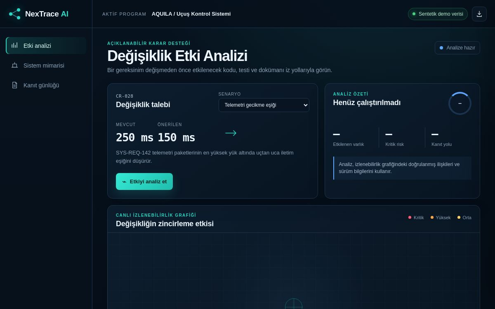

# NexTrace AI

NexTrace AI, kritik mühendislik projelerinde bir değişikliğin gereksinim, kod, test ve dokümanlar üzerindeki etkisini açıklanabilir kanıt zincirleriyle görünür kılmayı hedefleyen karar destek yazılımıdır.



*Görsel önceki arayüz sürümünden alınmıştır; güncel metrik ve davranışlar aşağıda açıklanır.*

## Mevcut sürüm — çalışan MVP temeli

Bu depo, ürün fikrini ve temel kullanıcı akışını doğrulayan **dinamik etki analizi motoru ile çalışan MVP temelini** içerir. Arayüz hazır sonuçları taklit etmez; Python API, yüklenen veya Jira/GitLab üzerinden eşitlenen izlenebilirlik grafiğini tarayarak etkilenen varlıkları, kanıt yollarını ve risk puanlarını hesaplar. Projeler, ayrı grafik sürümleri ve analiz geçmişi SQLite veritabanında kalıcı olarak tutulur. Yönetici ve analist rolleri proje bazlı erişimle ayrılır. Bağlayıcılar gerçek API sözleşmelerini kullanır; ancak sürüm henüz müşteri verisiyle doğrulanmış bir üretim kurulumu değildir.

Demoda üç örnek değişiklik senaryosu bulunur:

- Telemetri gecikme eşiğinin değiştirilmesi
- Şifreleme standardının yükseltilmesi
- Sensör örnekleme sıklığının artırılması

Kullanıcı örnek senaryolardan birini seçebilir veya aktif projenin yeni düğüm/ilişki CSV sürümünü yükleyebilir. İki grafik sürümü arasındaki eklenen, kaldırılan ve değiştirilen düğüm ve ilişkiler karşılaştırılabilir. Analiz çalıştırıldığında sistem:

- Etkilenen mühendislik varlıklarını,
- Kritik, yüksek ve orta düzey riskleri,
- Gereksinimden kod, test ve dokümana uzanan kanıt yollarını,
- Gerçek zaman damgası ve grafik sürümü içeren analiz kaydını

görselleştirir.

## Hesaplama yaklaşımı

Mevcut motor, yönlü graf üzerinde derinliği 5 ile sınırlı BFS ve açık bir puanlama formülü kullanır; eğitilmiş bir AI/LLM modeli içermez. Metadata doluluk oranı doğruluk olasılığı değildir. Mevcut/önerilen değer metinleri risk puanını değiştirmez. Ayrıntılar: [Teknik tasarım ve sınırlar](docs/TECHNICAL_DESIGN.md).

## Çalıştırma

Proje üçüncü taraf paket gerektirmeyen Python API ve web arayüzünden oluşur. Python 3.10 veya üzeri önerilir.

1. Depoyu indir veya klonla.
2. Proje klasöründe basit bir yerel sunucu başlat:

   ```bash
   python backend/server.py
   ```

3. Tarayıcıda `http://localhost:8000` adresini aç.
4. İlk açılışta yönetici e-posta adresini ve en az 12 karakterli parolanı belirle. Sonraki erişimlerde bu hesapla giriş yap. Yönetici tarafından oluşturulan hesaplar, geçici parolalarını ilk girişte değiştirmeden proje verilerine erişemez.

### Jira ve GitLab yapılandırması

Bağlayıcıları kullanacaksan `.env.example` dosyasındaki değişkenleri sunucu ortamında tanımla. `.env` dosyası uygulama tarafından otomatik okunmaz; değerleri işletim sistemine veya kullandığın gizli anahtar yöneticisine eklemelisin. Örnek:

```bash
export NEXTRACE_JIRA_BASE_URL="https://kurumunuz.atlassian.net"
export NEXTRACE_JIRA_EMAIL="kullanici@kurum.example"
export NEXTRACE_JIRA_API_TOKEN="..."
export NEXTRACE_GITLAB_BASE_URL="https://gitlab.com"
export NEXTRACE_GITLAB_TOKEN="..."
python backend/server.py
```

Yönetici hesabıyla **Bağlayıcılar** ekranına gir; NexTrace proje kimliğini, Jira proje anahtarını ve/veya GitLab proje yolunu yazıp eşitle. Jira issue bağlantıları ve commit mesajlarındaki Jira anahtarları açıklanabilir graf ilişkilerine dönüşür. Her eşitleme yeni bir grafik sürümü üretir.

Bağlayıcılar varsayılan olarak yalnızca HTTPS ve genel ağ adreslerini kabul eder. Kurum içi Jira/GitLab kurulumu için `NEXTRACE_ALLOW_PRIVATE_CONNECTORS=1` bilinçli olarak etkinleştirilmelidir. Erişim anahtarlarını depoya, tarayıcıya veya NexTrace veritabanına yazma; yalnızca sunucu ortam değişkenlerinde tut ve en düşük okuma yetkisini ver.

## Dosya yapısı

```text
.
├── index.html
├── styles.css
├── app.js
├── backend/
│   ├── server.py
│   ├── engine.py
│   ├── auth.py
│   ├── connectors.py
│   ├── storage.py
│   └── data/
│       ├── nodes.csv
│       └── edges.csv
├── tests/
│   ├── test_auth.py
│   ├── test_connectors.py
│   ├── test_engine.py
│   └── test_storage.py
├── docs/
│   └── nextrace-dashboard.png
└── assets/
    ├── nextrace-architecture.svg
    └── nextrace-architecture.png
```

## CSV veri şeması

`nodes.csv` sütunları:

```text
id,label,type,owner,criticality
```

`edges.csv` sütunları:

```text
source,target,relation,reason
```

`criticality`, -100…100 arasında tam sayı puan düzeltmesidir. `owner` ve `reason` boş olabilir; diğer alanlar zorunludur. Eksik/fazla sütunlar ve yinelenen kimlik/ilişkiler reddedilir.

Örnek dosyalar `backend/data/` klasöründedir. Web arayüzünde iki dosyayı seçtikten sonra analiz başlangıcı olacak düğüm kimliğini yazıp grafiği yükleyebilirsin.

## API

- `GET /api/health`: servis ve demo grafiği durumu
- `GET /api/auth/status`: ilk kurulum ve oturum durumu
- `GET /api/projects`: kalıcı proje listesi ve grafik büyüklükleri
- `GET /api/analyses?project_id=demo`: kayıtlı analiz geçmişi
- `GET /api/projects/versions?project_id=demo`: proje grafik sürümleri
- `GET /api/projects/diff?project_id=demo&from_version=...&to_version=...`: iki grafik sürümü arasındaki farklar
- `GET /api/users`: yönetici için kullanıcı listesi
- `GET /api/projects/access`: yönetici için proje üyelikleri
- `GET /api/connectors/status`: gizli değerleri göstermeden Jira/GitLab yapılandırma durumu
- `POST /api/auth/setup`: yalnızca ilk yönetici hesabını oluşturma
- `POST /api/auth/login`: güvenli oturum açma
- `POST /api/auth/logout`: oturumu sonlandırma
- `POST /api/auth/password`: oturum sahibinin parolasını değiştirme
- `POST /api/users`: yönetici tarafından kullanıcı oluşturma
- `POST /api/users/password-reset`: yönetici tarafından geçici parola atama
- `POST /api/users/status`: kullanıcı hesabını etkinleştirme veya devre dışı bırakma
- `POST /api/projects/access`: kullanıcıya proje yetkisi atama
- `POST /api/projects/import`: CSV metinlerinden kalıcı proje grafiği oluşturma
- `POST /api/connectors/sync`: Jira issue ve/veya GitLab commit verisinden yeni grafik sürümü oluşturma
- `POST /api/analyze`: seçilen düğümden dinamik etki analizi çalıştırma

## Test

```bash
python -m unittest discover -s tests -v
```

Tarayıcı akışı testi (yalnızca geliştirme için Node.js gerekir):

```bash
npm ci
npx playwright install chromium
npm run test:e2e
```

GitHub Actions aynı testleri her main güncellemesinde çalıştırır.

## Sonraki ürünleştirme adımları

- Test yönetim araçları ve doküman havuzları için bağlayıcılar
- Jira/GitLab bağlayıcılarını gerçek müşteri ortamında pilot verilerle doğrulama
- Grafik sürümleri için geri yükleme ve onay iş akışı
- Kurumsal kimlik sağlayıcı (SSO/OIDC) ve e-posta tabanlı hesap kurtarma
- Müşteri verisiyle doğrulanan risk modeli
- Kurum içi veya özel bulut kurulumu

## Güvenlik ve veri yaklaşımı

Hedef ürün, müşteri verilerini müşteri ortamında tutacak şekilde kurum içi veya özel bulut kurulumu için tasarlanmaktadır. Bu depodaki bütün örnekler sentetik veridir ve gerçek kurum verisi içermez.

- Parolalar PBKDF2-HMAC-SHA256 ve kullanıcıya özel rastgele salt ile saklanır.
- Oturum belirteçlerinin yalnızca SHA-256 özeti veritabanına yazılır.
- Oturum çerezi `HttpOnly` ve `SameSite=Strict` özelliklerini kullanır.
- Giriş denemeleri IP başına sınırlandırılır.
- Proje ve analiz API'leri kimlik doğrulama olmadan kullanılamaz.
- Analistler yalnızca atandıkları projeleri görebilir; `viewer` analiz çalıştıramaz.
- Kullanıcı oluşturma, proje içe aktarma ve yetki atama yalnızca yöneticiye açıktır.
- Her CSV içe aktarma işlemi mevcut grafiği silmeden yeni ve karşılaştırılabilir bir sürüm oluşturur.
- Jira/GitLab erişim anahtarları yalnızca sunucu ortamından okunur; durum API’sinde veya SQLite veritabanında tutulmaz.
- Bağlayıcılar yönlendirmeleri, aşırı büyük yanıtları ve varsayılan olarak özel/yerel ağ hedeflerini reddeder.
- Jira/GitLab eşitlemesi kaynak sistemlerde yazma işlemi yapmaz ve her başarılı eşitlemeyi yeni grafik sürümü olarak kaydeder.
- Yönetici parola sıfırladığında eski oturumlar kapatılır ve ilk girişte parola değişikliği zorunlu tutulur.
- Devre dışı bırakılan hesapların bütün açık oturumları iptal edilir; son aktif yönetici hesabı kapatılamaz.

Bu sürüm yerel prototiptir; internet üzerinden üretim kullanımı doğrulanmamıştır. İleride HTTPS arkasında bir dağıtım hazırlanırsa güvenli çerez ayarı:

```bash
NEXTRACE_SECURE_COOKIES=1 python backend/server.py
```

## Fikri mülkiyet

Bu proje açık kaynak lisansı altında yayımlanmamıştır. Tüm hakları saklıdır. Kaynak kodun kullanılması, kopyalanması, dağıtılması veya türev çalışmalarda kullanılması için hak sahibinden yazılı izin alınmalıdır.
